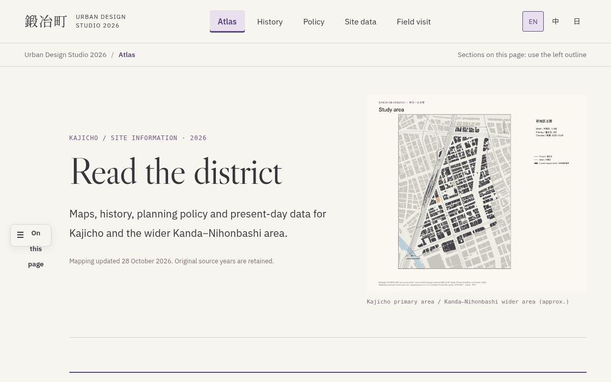

# Kajicho · Urban Design Studio 2026

GIS基図の取得、分析手法の確認、ウェブサイトコードの学習に使う公開授業資料です。

[English](README.md) | [简体中文](README.zh-CN.md) | **日本語**

**東京都・神田—日本橋と鍛冶町一・二丁目**を対象とする共通データ、QGISプロジェクト、分析コードです。Theme Bでは、建物のエネルギー・炭素、街路の日陰・放射環境、2050年に向けた計画と実施を扱います。

**[公開の地域資料サイトを開く](https://kajicho-site-atlas.specialgooood.chatgpt.site)** · [現在のGISデータ](04_Data/Ready/QGIS_Current_2026-11-04/README.md) · [データの出典](04_Data/Ready/QGIS_Current_2026-11-04/SOURCES.md)

画像をクリックしてサイトへ：[Atlas（地図）](https://kajicho-site-atlas.specialgooood.chatgpt.site/) · [History（歴史）](https://kajicho-site-atlas.specialgooood.chatgpt.site/history.html) · [Policy（計画・政策）](https://kajicho-site-atlas.specialgooood.chatgpt.site/policy.html) · [Site data（現況資料）](https://kajicho-site-atlas.specialgooood.chatgpt.site/conditions.html) · [Field visit（現地調査）](https://kajicho-site-atlas.specialgooood.chatgpt.site/field-visit.html)。

## 現在のGISデータ

**2026年11月4日版**は、**42.43712 haのwider boundary（周辺区域）**を使います。南側を含むすべての境界で、区域と交差する建物は元の輪郭全体を保持します。元の属性と分析対象の所属フィールドは変更していません。関東全域の元データ表は含みません。

| 内容 | ファイルと説明 |
| --- | --- |
| 178件のSHPデータセット | [レイヤー索引](04_Data/Ready/QGIS_Current_2026-11-04/metadata/Layer_Index.csv)、完全な属性と短縮フィールド名の対応表 |
| 192件のGeoPackageテーブル、うち14件は非空間テーブル | [Native data（完全な属性データ）](04_Data/Ready/QGIS_Current_2026-11-04/data) |
| 切り出した17件のラスター、368件のQGISレイヤー | [利用ガイド](04_Data/Ready/QGIS_Current_2026-11-04/README.md) |
| 出典リンク、資料年、処理方法 | [出典ガイド](04_Data/Ready/QGIS_Current_2026-11-04/SOURCES.md) |

1. リポジトリをcloneするか、ZIPをダウンロードして展開します。Git LFSは不要です。
2. フォルダ構成を保ち、QGISで `04_Data/Ready/QGIS_Current_2026-11-04/Kajicho_Current_Data.qgz` を開きます。
3. レイヤー索引から建物、計画、人口、アクセス、環境データを探します。SHPはSHX、DBF、PRJ、CPGと一緒に保持してください。

公開Siteの地図には、それぞれの公開日があります。上記の交付版が最新のダウンロード用GISです。推計値は元の手法と統計単位を保持するため、結合や集計の前に利用ガイドを確認してください。

## リポジトリを使う

| 作業 | 入口 |
| --- | --- |
| 公開サイトを実行・学習する | [サイトのソースとローカル実行ガイド](website/README.md) |
| チームで作業する | [Team start](docs/TEAM_START.md) · [作業計画](docs/PROJECT_PLAN.md) · [提出方法](CONTRIBUTING.md) |
| データとフィールドを調べる | [データガイド](docs/DATA_GUIDE.md) · [レイヤー一覧](04_Data/Metadata/Layer_Catalog.csv) · [フィールド一覧](04_Data/Metadata/Layer_Fields.csv) |
| 分析コードと手法を探す | [コード案内](CODE_INDEX.md) · [Theme Bの手法](03_Theme_B) · [処理スクリプト](08_Scripts) |
| 原資料・外部資料を取得する | [Data access](DATA_ACCESS.md) |
| 日付別の交付・試験を確認する | [交付記録](docs/CURRENT_DELIVERY.md) · [CFDの状態](docs/CFD_STATUS.md) · [研究レビュー](docs/Research_Review_2026-10-18/REPORT.md) |

## データの扱い

資料年、取得日、処理日は別々に保持します。建物のエネルギー値は推計です。建物年代は確定年、期間、未解決の根拠を区別します。各結果に対応する日付別の手法を参照してください。

QGISでは相対パスを使い、地図はPNGで出力します。SHPには付属ファイルを揃えます。プロジェクトの説明は英語を基本とし、中国語・日本語のREADMEも用意しています。ファイル名と原資料の用語は[言語規則](docs/LANGUAGE_GUIDE.md)を参照してください。
