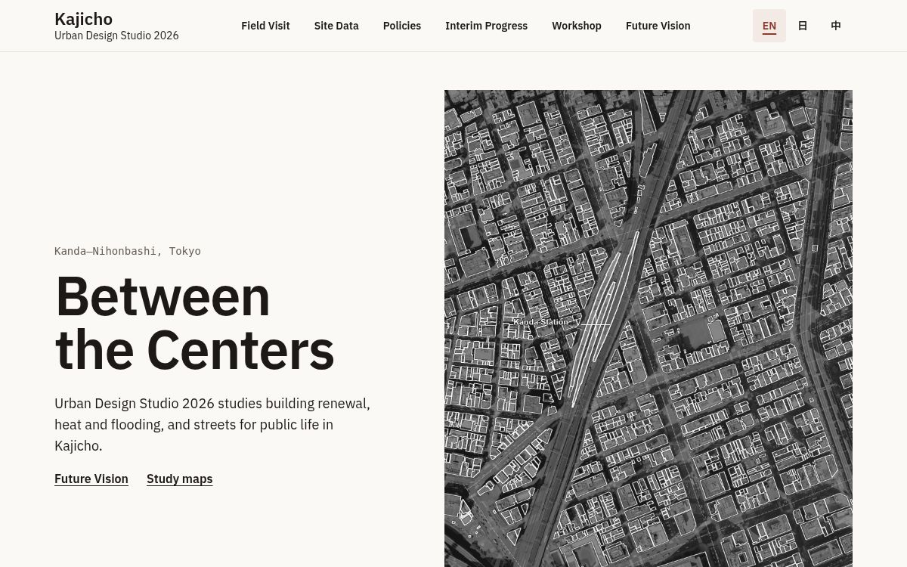

# Kajicho · Urban Design Studio 2026

**English** | [简体中文](README.zh-CN.md) | [日本語](README.ja.md)

Shared data, QGIS projects and analysis code for Theme B at the University of Tokyo. The studio studies building renewal, heat and flooding, and public space in Kanda–Nihonbashi, with a focus on Kajicho 1 & 2.

[Open the public Site](https://kajicho-site-atlas.specialgooood.chatgpt.site) · [Get the current GIS data](04_Data/Ready/QGIS_Current_2026-11-04/README.md) · [Browse the Site v52 source](website/README.md)

## Explore the studio

| Topic | Start here |
| --- | --- |
| 24 November workshop | [Meeting summary](https://kajicho-site-atlas.specialgooood.chatgpt.site/workshop) · [Full English report](https://kajicho-site-atlas.specialgooood.chatgpt.site/workshop-report) |
| 18 November interim exhibition | [Between the Centers](https://kajicho-site-atlas.specialgooood.chatgpt.site/studio) · [Studio timeline](docs/STUDIO_TIMELINE.md) |
| Site evidence | [Site Data](https://kajicho-site-atlas.specialgooood.chatgpt.site/conditions) · [Field Visit](https://kajicho-site-atlas.specialgooood.chatgpt.site/field-visit) · [History](https://kajicho-site-atlas.specialgooood.chatgpt.site/history) · [Policies](https://kajicho-site-atlas.specialgooood.chatgpt.site/policy) |
| Plan for 2050 | [Future Vision](https://kajicho-site-atlas.specialgooood.chatgpt.site/vision) · [Kajicho in 3D](https://kajicho-site-atlas.specialgooood.chatgpt.site/city-model) · [Scenario workbench](https://kajicho-site-atlas.specialgooood.chatgpt.site/scenario-workbench) |

## Current GIS data

The current QGIS project and its spatial layers use **EPSG:6677** for overlay, distance and area. [Coordinate reference and original source records](docs/COORDINATE_REFERENCE.md)

**[Download the Primary building SHP for ArcMap](https://raw.githubusercontent.com/Urshuaige/Urban-Design-Studio-2026-Kajicho-Public/main/04_Data/Ready/QGIS_Current_2026-11-04/shp/Primary_Building_Age_2026-11-13/Kajicho_Primary_Buildings_ArcMap.zip).** The ZIP includes the 2D layer, its companion files and the field guide. It covers 277 building models in Kajicho 1 & 2. Set unique values to `Byear` and label `0` as unknown. See the [full data and 3D faces](04_Data/Ready/QGIS_Current_2026-11-04/README.md#primary-buildings--26-november-2026).

The **4 November 2026** delivery uses the **42.43712 ha wider boundary**. Every intersecting building retains its complete source footprint, including the southern edge. Original attributes and analysis-membership fields are preserved. Kanto-wide original tables are excluded.

| Contents | Files and guidance |
| --- | --- |
| 179 SHP datasets | [Layer index](04_Data/Ready/QGIS_Current_2026-11-04/metadata/Layer_Index.csv), with full attributes and short-field mappings |
| 194 GeoPackage tables, including 14 nonspatial tables | [Native data](04_Data/Ready/QGIS_Current_2026-11-04/data) |
| 17 cropped rasters and 371 QGIS layers | [Delivery guide](04_Data/Ready/QGIS_Current_2026-11-04/README.md) |
| Source links, years and methods | [Source guide](04_Data/Ready/QGIS_Current_2026-11-04/SOURCES.md) |

1. Clone this repository or download and extract its ZIP. Git LFS is not required.
2. Keep the folder tree intact and open `04_Data/Ready/QGIS_Current_2026-11-04/Kajicho_Current_Data.qgz` in QGIS.
3. Use the layer index to find building, planning, population, access and environmental data. Keep each SHP with its SHX, DBF, PRJ and CPG files.

The public Site keeps its published map dates. The delivery above is the latest downloadable GIS snapshot. Existing estimates retain their original methods and statistical units; see the delivery guide before combining or summing them.

## Work with the repository

| Task | Start here |
| --- | --- |
| Run and study the public website | [Website source and local run guide](website/README.md) |
| Join the team workflow | [Team start](docs/TEAM_START.md) · [Project plan](docs/PROJECT_PLAN.md) · [Contributing](CONTRIBUTING.md) |
| Understand datasets and fields | [Data guide](docs/DATA_GUIDE.md) · [Layer catalog](04_Data/Metadata/Layer_Catalog.csv) · [Field catalog](04_Data/Metadata/Layer_Fields.csv) |
| Find analysis code and methods | [Code map](CODE_INDEX.md) · [Theme B methods](03_Theme_B) · [Scripts](08_Scripts) |
| Find original or external materials | [Data access](DATA_ACCESS.md) |
| Review dated releases and experiments | [Delivery history](docs/CURRENT_DELIVERY.md) · [CFD status](docs/CFD_STATUS.md) · [Research review](docs/Research_Review_2026-10-18/REPORT.md) |

## Data conventions

Source years, acquisition dates and processing dates remain separate. Building energy values are estimates, and building-age records retain exact years, intervals and unresolved evidence. Read the dated source method for each result.

Use relative paths for QGIS projects. Map exports use PNG; SHP deliveries include all companion files. Project documentation uses English with Chinese and Japanese README entries. See the [language guide](docs/LANGUAGE_GUIDE.md) for filenames and source terminology.
