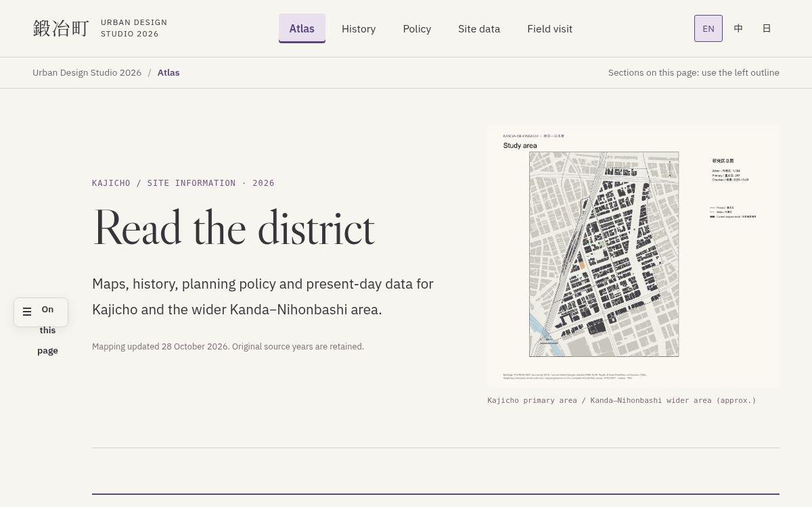

# Kajicho · Urban Design Studio 2026

Public teaching copy for downloading GIS base maps, reading analysis methods and studying the website code.

**English** | [简体中文](README.zh-CN.md) | [日本語](README.ja.md)

Shared data, QGIS projects and analysis code for **Kanda–Nihonbashi and Kajicho 1 & 2, Tokyo**. Theme B explores building energy and carbon, street shade and radiation, and planning and implementation towards 2050.

**[Open the public Site Atlas](https://kajicho-site-atlas.specialgooood.chatgpt.site)** · [Get current GIS data](04_Data/Ready/QGIS_Current_2026-11-04/README.md) · [Browse sources](04_Data/Ready/QGIS_Current_2026-11-04/SOURCES.md)

Click the preview to explore the public site: [Atlas](https://kajicho-site-atlas.specialgooood.chatgpt.site/) · [History](https://kajicho-site-atlas.specialgooood.chatgpt.site/history.html) · [Policy](https://kajicho-site-atlas.specialgooood.chatgpt.site/policy.html) · [Site data](https://kajicho-site-atlas.specialgooood.chatgpt.site/conditions.html) · [Field visit](https://kajicho-site-atlas.specialgooood.chatgpt.site/field-visit.html).

## Current GIS data

**13 November update:** [Primary building age](04_Data/Ready/QGIS_Current_2026-11-04/shp/Primary_Building_Age_2026-11-13/) uses the newly supplied 277-building SHP in the QGIS project; 56 years are missing and the underlying year source has not been supplied. The older age views continue outside the primary area. [Details](04_Data/Ready/QGIS_Current_2026-11-04/README.md#primary-building-age-update--13-november-2026).

The **4 November 2026** delivery uses the **42.43712 ha wider boundary**. Every intersecting building retains its complete source footprint, including the southern edge. Original attributes and analysis-membership fields are preserved. Kanto-wide original tables are excluded.

| Contents | Files and guidance |
| --- | --- |
| 179 SHP datasets | [Layer index](04_Data/Ready/QGIS_Current_2026-11-04/metadata/Layer_Index.csv), with full attributes and short-field mappings |
| 192 GeoPackage tables, including 14 nonspatial tables | [Native data](04_Data/Ready/QGIS_Current_2026-11-04/data) |
| 17 cropped rasters and 368 QGIS layers | [Delivery guide](04_Data/Ready/QGIS_Current_2026-11-04/README.md) |
| Source links, years and methods | [Source guide](04_Data/Ready/QGIS_Current_2026-11-04/SOURCES.md) |

1. Clone this repository or download and extract its ZIP. Git LFS is not required.
2. Keep the folder tree intact and open `04_Data/Ready/QGIS_Current_2026-11-04/Kajicho_Current_Data.qgz` in QGIS.
3. Use the layer index to find building, planning, population, access and environmental data. Keep each SHP with its SHX, DBF, PRJ and CPG files.

The public Site keeps its published map dates. The delivery above is the latest downloadable GIS snapshot. Existing estimates retain their original methods and statistical units; see the delivery guide before combining or summing them.

## Work with the repository

| Task | Start here |
| --- | --- |
| Run and study the public website | [Website source and local run guide](website/README.md) |
| Join the team workflow | [Team start](docs/TEAM_START.md) · [Project plan](docs/PROJECT_PLAN.md) · [Contributing](CONTRIBUTING.md) |
| Understand datasets and fields | [Data guide](docs/DATA_GUIDE.md) · [Layer catalog](04_Data/Metadata/Layer_Catalog.csv) · [Field catalog](04_Data/Metadata/Layer_Fields.csv) |
| Find analysis code and methods | [Code map](CODE_INDEX.md) · [Theme B methods](03_Theme_B) · [Scripts](08_Scripts) |
| Find original or external materials | [Data access](DATA_ACCESS.md) |
| Review dated releases and experiments | [Delivery history](docs/CURRENT_DELIVERY.md) · [CFD status](docs/CFD_STATUS.md) · [Research review](docs/Research_Review_2026-10-18/REPORT.md) |

## Data conventions

Source years, acquisition dates and processing dates remain separate. Building energy values are estimates, and building-age records retain exact years, intervals and unresolved evidence. Read the dated source method for each result.

Use relative paths for QGIS projects. Map exports use PNG; SHP deliveries include all companion files. Project documentation uses English with Chinese and Japanese README entries. See the [language guide](docs/LANGUAGE_GUIDE.md) for filenames and source terminology.
