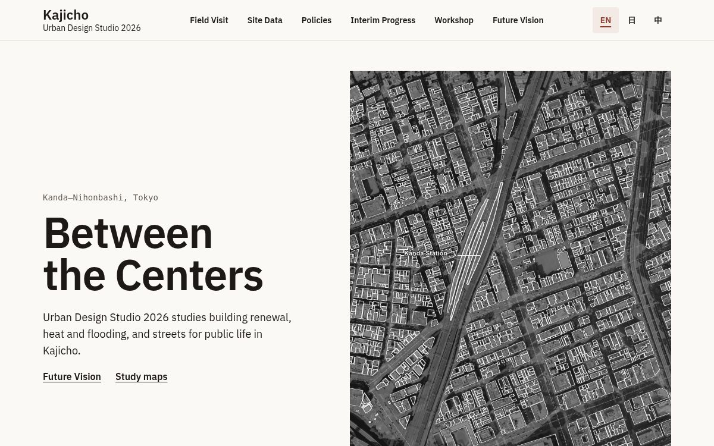

# Kajicho · Urban Design Studio 2026

[English](README.md) | **简体中文** | [日本語](README.ja.md)

东京大学城市设计工作室 Theme B 的公开课程资料，包含数据、QGIS 工程和分析代码。研究聚焦鍛冶町一、二丁目，讨论神田—日本桥地区的建筑更新、暑热与洪涝，以及公共空间。

[打开公开 Site](https://kajicho-site-atlas.specialgooood.chatgpt.site) · [下载当前 GIS 数据](04_Data/Ready/QGIS_Current_2026-11-04/README.md) · [浏览 Site 第 52 版源码](website/README.md)

**[下载重点区建筑 SHP（ArcMap）](https://raw.githubusercontent.com/Urshuaige/Urban-Design-Studio-2026-Kajicho-Public/main/04_Data/Ready/QGIS_Current_2026-11-04/shp/Primary_Building_Age_2026-11-13/Kajicho_Primary_Buildings_ArcMap.zip)。** ZIP 包含 277 个建筑的二维平面投影、配套文件和字段对照。用 `Byear` 分类，`0` 表示年份未知。[完整属性与三维表面](04_Data/Ready/QGIS_Current_2026-11-04/README.md#primary-buildings--26-november-2026)。

## 项目入口

| 内容 | 链接 |
| --- | --- |
| 11 月 24 日工作会议 | [会议摘要](https://kajicho-site-atlas.specialgooood.chatgpt.site/workshop) · [英文详细报告](https://kajicho-site-atlas.specialgooood.chatgpt.site/workshop-report) |
| 11 月 18 日中期成果 | [Between the Centers 成果展](https://kajicho-site-atlas.specialgooood.chatgpt.site/studio) · [项目时间线](docs/STUDIO_TIMELINE.md) |
| 场地资料 | [现状数据](https://kajicho-site-atlas.specialgooood.chatgpt.site/conditions) · [场地调研](https://kajicho-site-atlas.specialgooood.chatgpt.site/field-visit) · [历史](https://kajicho-site-atlas.specialgooood.chatgpt.site/history) · [规划政策](https://kajicho-site-atlas.specialgooood.chatgpt.site/policy) |
| 2050 规划 | [未来愿景](https://kajicho-site-atlas.specialgooood.chatgpt.site/vision) · [鍛冶町 3D](https://kajicho-site-atlas.specialgooood.chatgpt.site/city-model) · [方案比较](https://kajicho-site-atlas.specialgooood.chatgpt.site/scenario-workbench) |

## 当前 GIS 数据

当前 QGIS 工程与空间图层统一采用 **EPSG:6677**，用于空间叠加、距离和面积计算。新版 Primary 年龄数据包括 277 栋建筑，其中 56 栋的年份为空。原始来源、数据年份和许可未记录。 [坐标与数据说明](docs/COORDINATE_REFERENCE.md)

**2026 年 11 月 4 日交付版**使用 **42.43712 ha 的 wider boundary（外围范围）**。所有与边界相交的建筑均保留完整源轮廓，包括南部边缘；原属性和分析成员标记保持不变。关东全域原表未纳入。

| 内容 | 文件与说明 |
| --- | --- |
| 179 份 SHP | [图层索引](04_Data/Ready/QGIS_Current_2026-11-04/metadata/Layer_Index.csv)，附完整属性和短字段对照 |
| 192 张 GeoPackage 表，其中含 14 张非空间表 | [Native data（完整字段数据）](04_Data/Ready/QGIS_Current_2026-11-04/data) |
| 17 份裁剪栅格、369 个 QGIS 图层 | [交付说明](04_Data/Ready/QGIS_Current_2026-11-04/README.md) |
| 来源链接、年份与处理方法 | [来源说明](04_Data/Ready/QGIS_Current_2026-11-04/SOURCES.md) |

1. 克隆仓库，或下载 ZIP 后解压。无需 Git LFS。
2. 保持目录结构，在 QGIS 打开 `04_Data/Ready/QGIS_Current_2026-11-04/Kajicho_Current_Data.qgz`。
3. 通过图层索引查找建筑、规划、人口、可达性和环境数据。SHP 应与 SHX、DBF、PRJ、CPG 配套文件一同保留。

公开 Site 保留其地图发布日期；上方交付版是最新可下载的 GIS 快照。已有估算保留原方法和统计单元，合并或汇总前请阅读交付说明。

## 使用仓库

| 任务 | 入口 |
| --- | --- |
| 运行和学习公开网站 | [网站源码与本地运行说明](website/README.md) |
| 参与团队协作 | [Team start（接手说明）](docs/TEAM_START.md) · [Project plan（工作计划）](docs/PROJECT_PLAN.md) · [Contributing（提交方法）](CONTRIBUTING.md) |
| 理解数据和字段 | [数据规范](docs/DATA_GUIDE.md) · [图层目录](04_Data/Metadata/Layer_Catalog.csv) · [字段目录](04_Data/Metadata/Layer_Fields.csv) |
| 查找分析代码和方法 | [代码入口](CODE_INDEX.md) · [Theme B 方法](03_Theme_B) · [处理脚本](08_Scripts) |
| 查找原始和外部资料 | [Data access（资料获取）](DATA_ACCESS.md) |
| 核对日期版交付和试验 | [交付记录](docs/CURRENT_DELIVERY.md) · [CFD 状态](docs/CFD_STATUS.md) · [研究综述](docs/Research_Review_2026-10-18/REPORT.md) |

## 数据约定

资料年份、获取日期和处理日期分别保留。建筑能源值仍为估算；建筑年代保留确切年份、区间与未解决的证据。使用结果时以对应的日期版方法为准。

QGIS 工程使用相对路径，地图输出 PNG，SHP 交付保留全部配套文件。项目说明默认使用英文，并提供中、日文 README。文件命名与原始术语见[语言规范](docs/LANGUAGE_GUIDE.md)。
