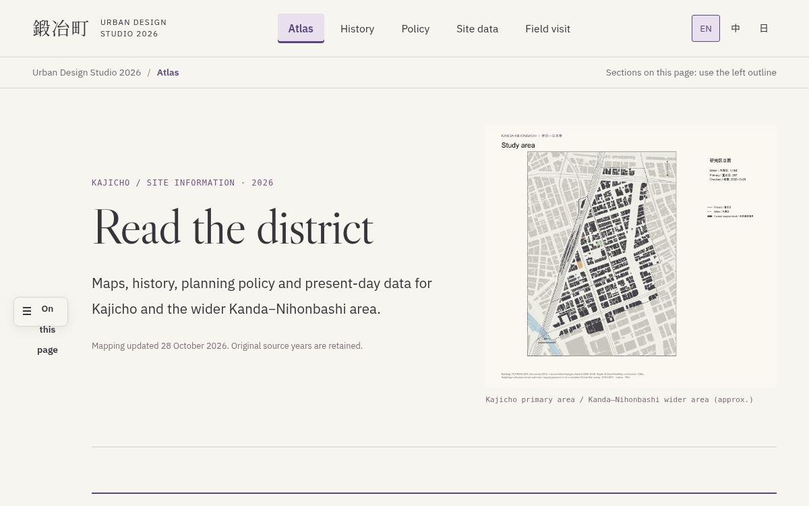

# Kajicho · Urban Design Studio 2026

公开课程资料版本，用于下载 GIS 底图、查看分析方法和学习网站代码。

[English](README.md) | **简体中文** | [日本語](README.ja.md)

**东京神田—日本桥与鍛冶町一・二丁目**的共用数据、QGIS 工程和分析代码。Theme B 围绕建筑能源与碳、街道遮阴与辐射环境，以及面向 2050 年的规划与实施开展工作。

**[打开公开场地资料站](https://kajicho-site-atlas.specialgooood.chatgpt.site)** · [获取当前 GIS 数据](04_Data/Ready/QGIS_Current_2026-11-04/README.md) · [查看数据来源](04_Data/Ready/QGIS_Current_2026-11-04/SOURCES.md)

点击预览进入网站：[Atlas（场地图集）](https://kajicho-site-atlas.specialgooood.chatgpt.site/) · [History（历史）](https://kajicho-site-atlas.specialgooood.chatgpt.site/history.html) · [Policy（规划政策）](https://kajicho-site-atlas.specialgooood.chatgpt.site/policy.html) · [Site data（现状资料）](https://kajicho-site-atlas.specialgooood.chatgpt.site/conditions.html) · [Field visit（现场调研）](https://kajicho-site-atlas.specialgooood.chatgpt.site/field-visit.html)。

## 当前 GIS 数据

**2026 年 11 月 4 日交付版**使用 **42.43712 ha 的 wider boundary（外围范围）**。所有与边界相交的建筑均保留完整源轮廓，包括南部边缘；原属性和分析成员标记保持不变。关东全域原表未纳入。

| 内容 | 文件与说明 |
| --- | --- |
| 178 份 SHP | [图层索引](04_Data/Ready/QGIS_Current_2026-11-04/metadata/Layer_Index.csv)，附完整属性和短字段对照 |
| 192 张 GeoPackage 表，其中含 14 张非空间表 | [Native data（完整字段数据）](04_Data/Ready/QGIS_Current_2026-11-04/data) |
| 17 份裁剪栅格、368 个 QGIS 图层 | [交付说明](04_Data/Ready/QGIS_Current_2026-11-04/README.md) |
| 来源链接、年份与处理方法 | [来源说明](04_Data/Ready/QGIS_Current_2026-11-04/SOURCES.md) |

1. 克隆仓库，或下载 ZIP 后解压。无需 Git LFS。
2. 保持目录结构，在 QGIS 打开 `04_Data/Ready/QGIS_Current_2026-11-04/Kajicho_Current_Data.qgz`。
3. 通过图层索引查找建筑、规划、人口、可达性和环境数据。SHP 应与 SHX、DBF、PRJ、CPG 配套文件一同保留。

公开 Site 保留其地图发布日期；上方交付版是最新可下载的 GIS 快照。已有估算保留原方法和统计单元，合并或汇总前请阅读交付说明。

## 使用仓库

| 任务 | 入口 |
| --- | --- |
| 运行和学习公开网站 | [网站源码与本地运行说明](website/README.md) |
| 参与团队协作 | [Team start（接手说明）](docs/TEAM_START.md) · [Project plan（工作计划）](docs/PROJECT_PLAN.md) · [Contributing（提交方法）](CONTRIBUTING.md) |
| 理解数据和字段 | [数据规范](docs/DATA_GUIDE.md) · [图层目录](04_Data/Metadata/Layer_Catalog.csv) · [字段目录](04_Data/Metadata/Layer_Fields.csv) |
| 查找分析代码和方法 | [代码入口](CODE_INDEX.md) · [Theme B 方法](03_Theme_B) · [处理脚本](08_Scripts) |
| 查找原始和外部资料 | [Data access（资料获取）](DATA_ACCESS.md) |
| 核对日期版交付和试验 | [交付记录](docs/CURRENT_DELIVERY.md) · [CFD 状态](docs/CFD_STATUS.md) · [研究综述](docs/Research_Review_2026-10-18/REPORT.md) |

## 数据约定

资料年份、获取日期和处理日期分别保留。建筑能源值仍为估算；建筑年代保留确切年份、区间与未解决的证据。使用结果时以对应的日期版方法为准。

QGIS 工程使用相对路径，地图输出 PNG，SHP 交付保留全部配套文件。项目说明默认使用英文，并提供中、日文 README。文件命名与原始术语见[语言规范](docs/LANGUAGE_GUIDE.md)。
