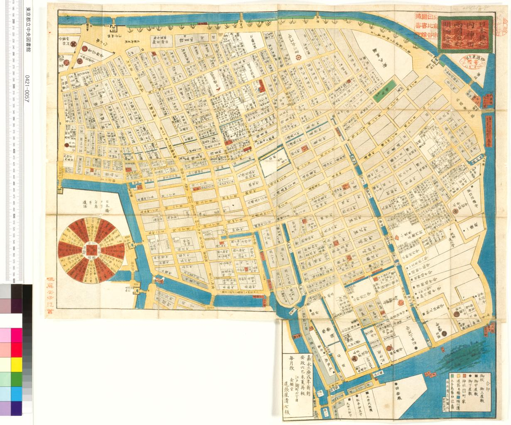
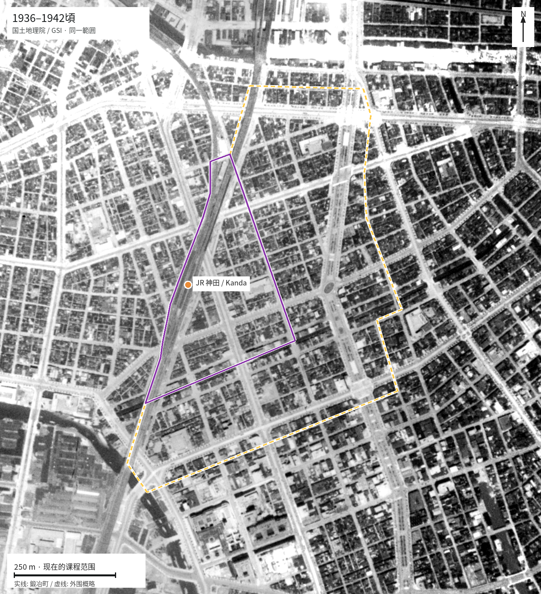
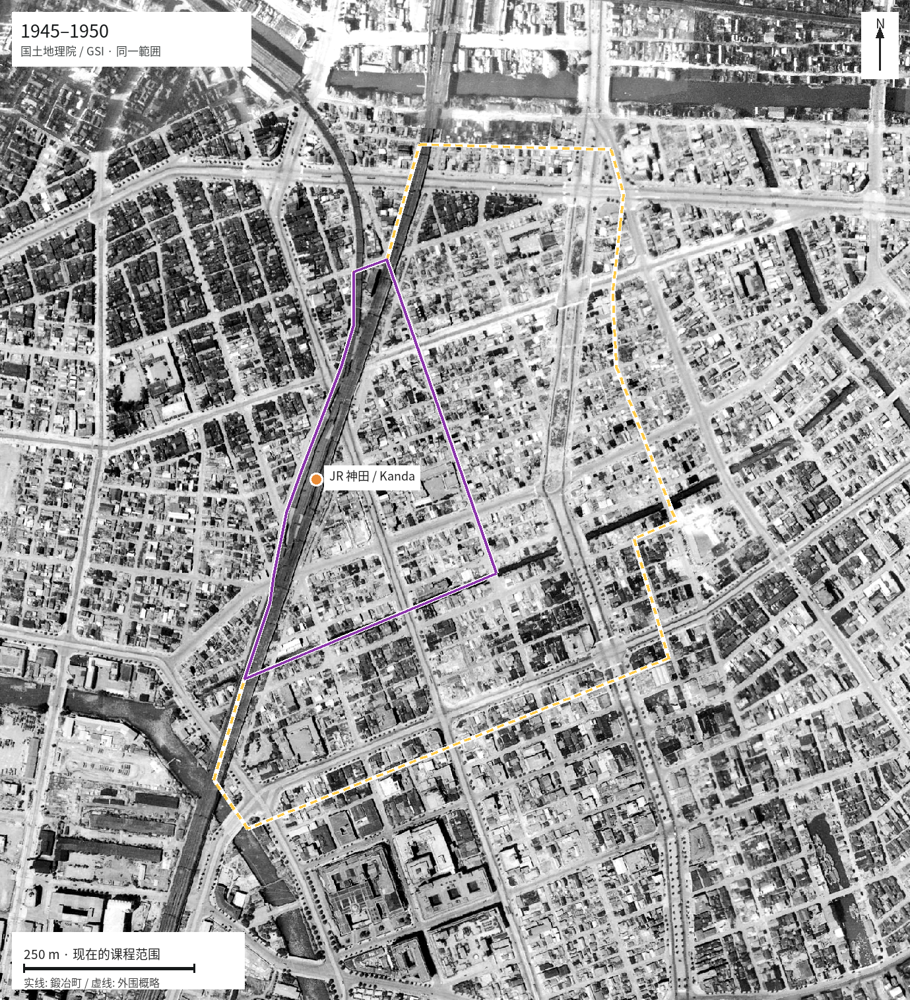
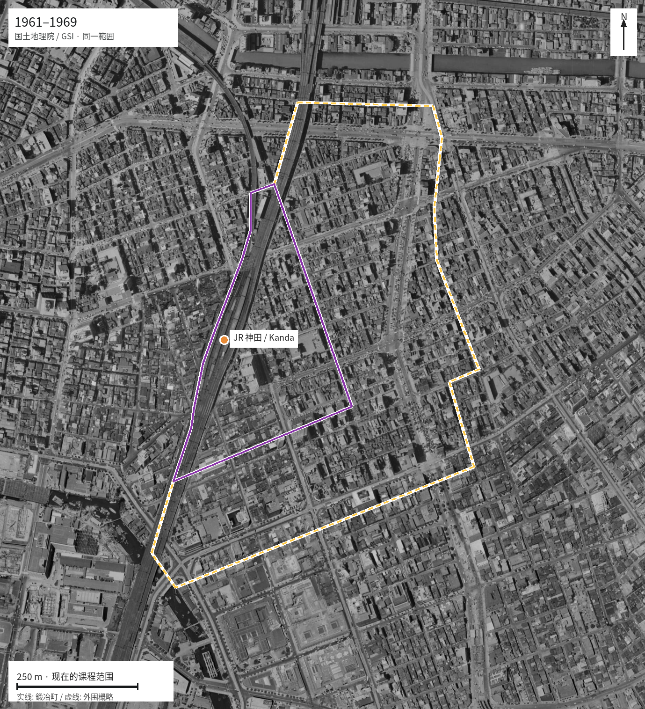
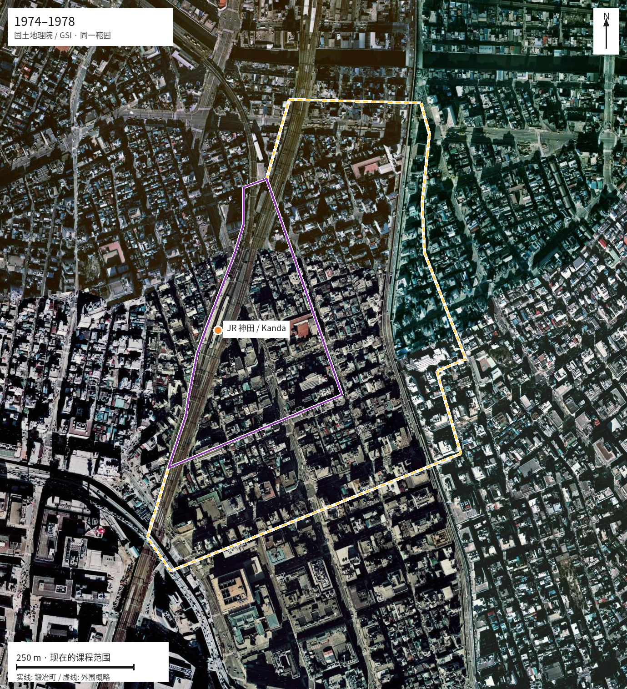
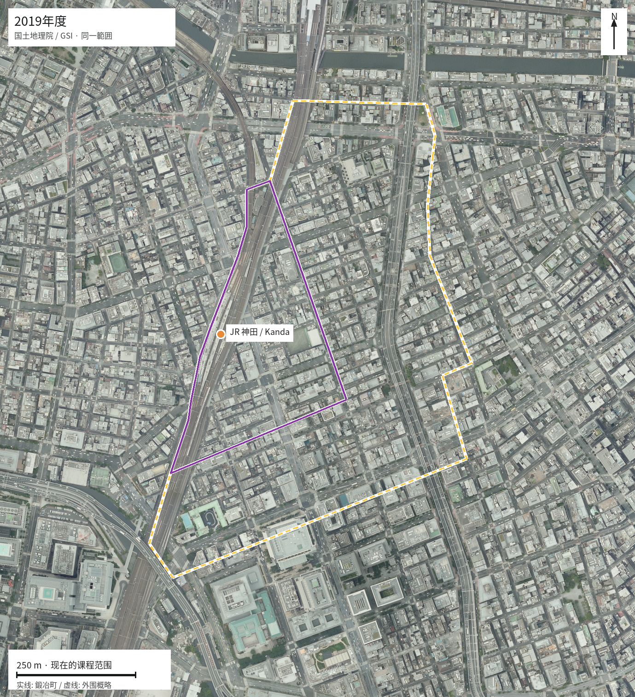
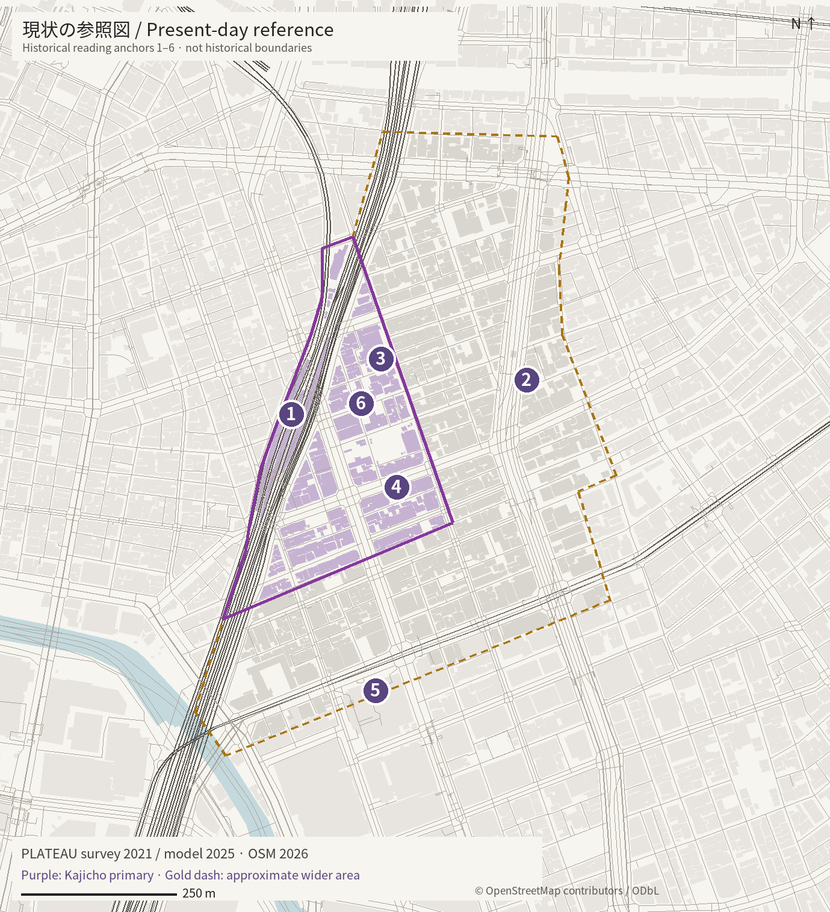

# 鍛冶町历史与现状

资料核查日期沿用原站：2026-10-24。

鍛冶町的特征来自多层网络的叠合：工匠与贸易、复兴街道、铁路可达性，以及建筑和地方组织的多次更新。

## 1603–1918 / 工匠街区与水运

文化与生业：鍛冶职人与金物商聚集；1824 年的记录也包含书籍、鞋履与药品商店。

建设：沿街商业与河道联系形成地方网络。竜閑川曾于 1857 年填埋，1883 年重开。

政策：1603 年町割与后来的行政变化塑造地区；旧町名保留了不同工种的线索。

来源：S01, S02, S03, S15

## 1919–1944 / 铁路枢纽与震灾复兴

文化与生业：车站可达性改变了贸易与日常往来的条件；祭礼形式也随近代设施调整。

建设：1919 年 JR 神田站开业，1931 年地下铁神田站开业。1923 年震灾之后重整道路与街区。

政策：至 1930 年的帝都复兴通过区画整理，形成昭和通り等宽幅道路与街区内道路。

来源：S04, S05, S06, S07

## 1945–1960 / 战损与重建

文化与生业：金物商服务战后重建。神田祭战后的首次神幸祭在 1952 年举行。

建设：空袭破坏造成城市肌理缺口；竜閑川在战后瓦砾处理中于 1950 年填埋。

政策：战后复兴与 1950 年《建筑基准法》构成重建背景；町会组织也经历制度变化。

来源：S02, S03, S04, S07, S08

## 1961–1973 / 机动车交通与建筑增高

文化与生业：道路交通影响祭礼时间与组织；日常移动在铁路与道路网络上展开。

建设：办公楼面需求与机动车基础设施改变都心；逐地块更新带来不同建筑形态。

政策：1963 年引入容积地区制度，1970 年进一步全面导入容积率控制；需区分地方指定。

来源：S04, S07, S11, S12

## 1974–1990 / 办公增长与地方延续

文化与生业：行业记忆与地方组织在经营环境变化中延续。

建设：1970 年代与 1980 年代末的影像可沿同一街道比较屋顶体量与空地。

政策：1974 年住居表示形成现行鍛冶町一、二丁目名称。1987 年区方针开始回应定住人口问题。

来源：S02, S08, S09, S14

## 1991–2020 / 居住回归与用途混合

文化与生业：居民、工作者和来访者有不同日常节奏，一层店铺和活动需要单独调查。

建设：更新与再利用并存。2019 年航空照片与现有建筑、兴趣点图层配套阅读。

政策：区级节点包括 1992 年住宅措施、1997 年千代田区型地区计划与 1998 年总体规划。

来源：S09, S14, S17

## 2021 → 2050 / 修补、连接与气候行动

文化与生业：地方规划支持居住、工作与交流空间，也赋予旧今川中学校社区与防灾作用。

建设：街道连接、可用的一层空间与建筑安全可以协同改善，具体措施需现场与地块核查。

政策：2021 年总体规划与同年 11 月气候宣言，提出通往 2050 净零排放的方向。

来源：S10, S13, S17

## 铁路与穿越

JR 神田站于 1919 年开业。现有高架与桥下通道组织车站周边的进入方式。

车站集聚活动，铁路又将东西向移动导向有限的穿越点。

来源：S05, S17

## 宽幅道路与小街

1923 年震灾复兴形成昭和通り等干道与大量街区内道路。

现状道路层级由复兴骨架与细部通行叠合形成，不能把每条窄巷都归为江户遗存。

来源：S04, S10, S14

## 高度与密度

1963–70 年建筑制度转向容积率控制；现有 PLATEAU 数据呈现多种建筑形态。

高度差可由道路条件、地块尺度、更新时点与制度共同解释；建成年代和产权须另查。

来源：S04, S11, S12, S17

## 行业与建筑使用

官方地方史将金物业与鍛冶町、战后金物通り联系起来。

底层经营可在建筑替换后延续商业记忆；兴趣点数量无法代替就业与楼层用途。

来源：S01, S02, S17

## 旧河道与地形

竜閑川经历填埋、重开与再次填埋，桥名留存；神田位于区东侧低地一带。

线性空间与区界可作为旧基础设施痕迹阅读；当前淹水深度须依据对应灾害情景。

来源：S03, S04, S17

## 文化与地区维护

祭礼与町会的形式曾多次变化；现行地方规划重视交流与社区设施。

延续也存在于反复发生的协作中。今日参与者与使用方式需要地方叙述核实。

来源：S07, S08, S10

## 来源

- [S01 / Kajicho 1 town-name record](https://www.city.chiyoda.lg.jp/koho/kurashi/volunteer/chomeiyuraiban/choumei/kaji-1.html)。资料年份：1603; 1804–1818; 1824
- [S02 / Kajicho 2 town-name record](https://www.city.chiyoda.lg.jp/koho/kurashi/volunteer/chomeiyuraiban/choumei/kaji-2.html)。资料年份：Edo; Meiji; postwar; 1974
- [S03 / Ryukan River / Chiyoda newsletter No.1582](https://www.city.chiyoda.lg.jp/documents/27757/no1582.pdf)。资料年份：1691; 1857; 1883; 1950
- [S04 / History of Chiyoda streetscape](https://www.city.chiyoda.lg.jp/documents/26394/guideline-4.pdf)。资料年份：Edo–2000s
- [S05 / Kanda station information](https://www.jreast.co.jp/estation/station/info.aspx?StationCD=538)。资料年份：1919-03-01
- [S06 / Ginza Line former stations](https://www.tokyometro.jp/news/2017/190616.html)。资料年份：1930–1931
- [S07 / History of Kanda Matsuri](https://www.kandamatsuri.com/about/)。资料年份：Edo–postwar
- [S08 / History of town associations](https://www.city.chiyoda.lg.jp/koho/kurashi/volunteer/chokai-rengochokai/chokai-naritachi.html)。资料年份：Edo–1960s
- [S09 / 2021 master plan / Chapter 1](https://www.city.chiyoda.lg.jp/documents/17862/toshimasu-1_2.pdf)。资料年份：1987; 1992; 1997; 1998; 1999; 2013; 2016; 2017
- [S10 / 2021 master plan / Chapter 4](https://www.city.chiyoda.lg.jp/documents/17862/toshimasu-4_2.pdf)。资料年份：2021 policy
- [S11 / 1963 floor-area districts / 1998 Economic Survey](https://www5.cao.go.jp/keizai3/keizaiwp/wp-je98/wp-je98-00305.html)。资料年份：1963; 1997–1998
- [S12 / 1970 planning and height-regulation context](https://www.mlit.go.jp/pri/kikanshi/pdf/pri_review_40.pdf)。资料年份：1970
- [S13 / 2050 Zero Carbon Chiyoda](https://www.city.chiyoda.lg.jp/koho/machizukuri/kankyo/2050zerocarbonchiyoda.html)。资料年份：2021-11 declaration; 2050 target
- [S14 / GSI tile list and use conditions](https://maps.gsi.go.jp/development/ichiran.html)。资料年份：1936–42; 1945–50; 1961–69; 1974–78; 1987–90; FY2019
- [S15 / Nihonbashi-kita Uchikanda map](https://archive.library.metro.tokyo.lg.jp/da/detail?tilcod=0000000013-00042247)。资料年份：1850 original / 1859 reprint
- [S16 / Official study boundaries / Figure 5](https://github.com/Urshuaige/Urban-Design-Studio-2026-Kajicho/blob/main/docs/COURSE_BOUNDARIES.md)。资料年份：2026
- [S17 / Current mapped baseline](../conditions.html)。资料年份：PLATEAU survey2021 / model2025; POIs2026
